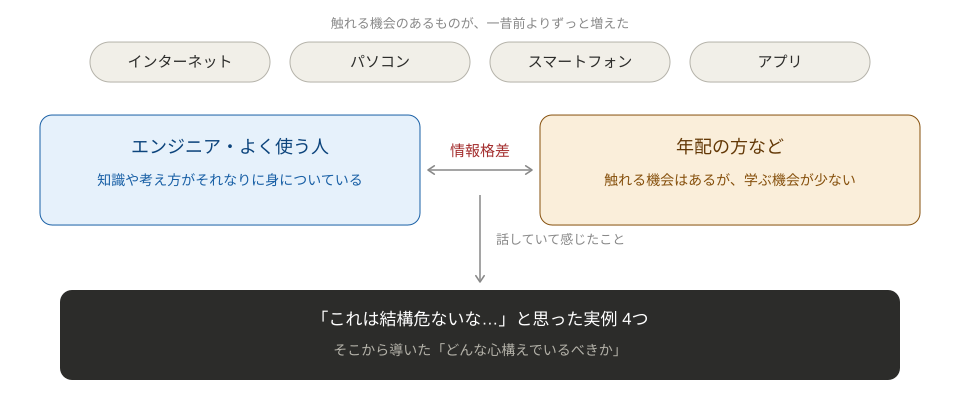
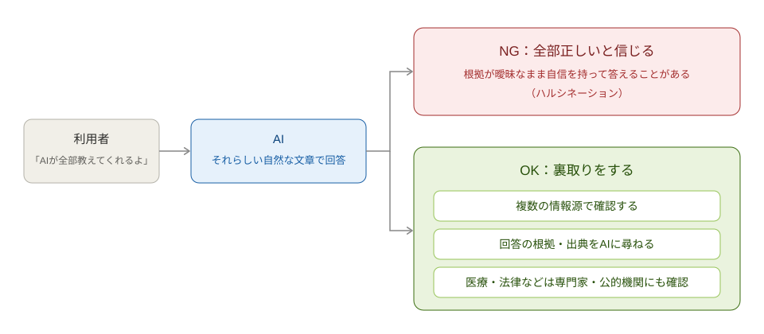
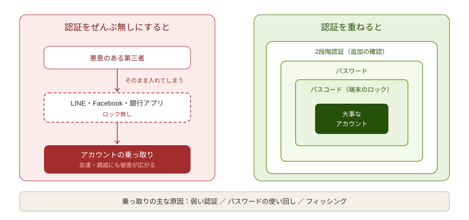
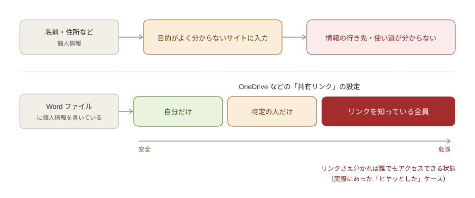
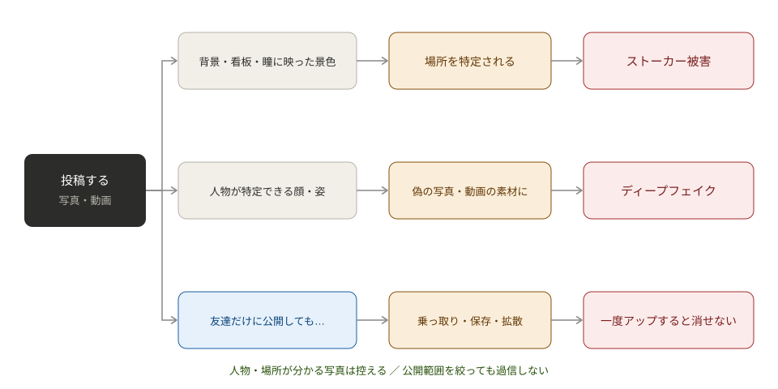
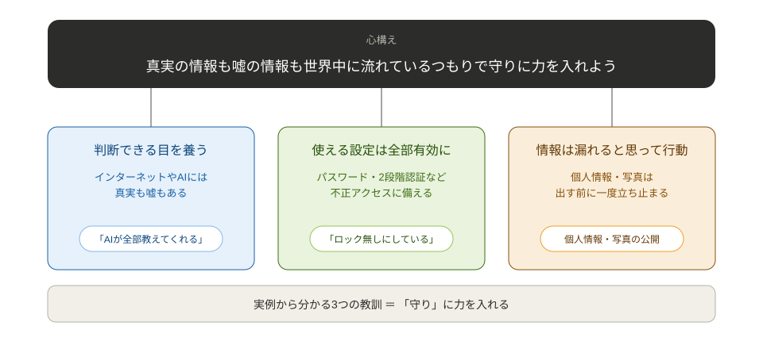

# これなに

一昔前と違い、今はインターネットやパソコン、スマートフォン、アプリなど、触れる機会のあるものがたくさんあります。
エンジニアを本職としている人やよくパソコンやスマートフォンを使う機会のある人たちであればそれなりに知識や考え方が身についていると思います。

一方で、最近年配の方たちと話をすることがあるのですが、あまりに情報格差が広がっているなと思いました。特に「これは結構危ないな…」と話をしていて感じたことをこの記事で紹介しつつ、どういった心構えでいるべきかを書いてみます。

# 対象読者

以下のような方に対して記事を書いています。

- パソコンやスマートフォンに不安のある方
- ITの知識を学ぶ機会がない方
- IT初心者
- 年配の方々が実際にどんなことをしているかのサンプルケースを読んでみたい方

「何言ってるのかよくわからない」「何を当たり前のことを言っているんだ」という内容になっているかもしれませんが、そういった疑問や感想があればぜひコメントに書いてくれると嬉しいです。

なお、わかりにくい用語については末尾にまとめて補足として記載しておりますので、必要に応じてご覧ください。

# まず結論の心構えは「真実の情報も嘘の情報も世界中に流れているつもりで守りに力を入れよう」

少しカッコつけた格言のようになってしまっていますが、いろいろ突き詰めるとこの話に行きつくような気がします。

キーワードは「情報」と「世界」、「守り」の3つです。
正直いろいろな観点があるのでワンライナーで書くことは難しいですが、実際にあった話のうち「これは危ないな」と思ったことを抽象化した結果、この表現にまとまりました。

では実際に自分が出会った実際の話を以下に紹介してみます。

# 実際にあった「危ないな」と思った話

## 「AIが全部教えてくれるよ」

これは年配の方が意気揚々とおっしゃっていた言葉そのままです。
この記事を読まれているほとんどの方々が「これは絶対にだめだ」と瞬時にお分かりになるかと思いますが、いわゆるハルシネーションのリスクがある考え方になっています。

AIは自然言語（人間が使うような自然な言葉）でそれらしい回答をしてくれます。しかし実際には自信を持って根拠が曖昧なまま回答してくることもあり、医療や法律など相対的に難解な分野ではこのハルシネーションが問題になるので要注意な話の一つです。

そのため、AIに訊くときは本当に根拠や事実を元にして回答しているのか、想像で回答していないか等を意識しつつ、複数の情報源で裏取りをしたり回答の根拠や出典を尋ねるなどして正確性を極力検証いただいた方が良いと考えております。

## 「パスワードとか要らないからLINEとかFacebookはロック無しにしているんだ」

まさかそんなことあり得ないだろうと思うじゃないですか。
でも実際おっしゃっている方は多く、みなさんの中にも似たようなフレーズを耳にしたことがあるかもしれません。

パスワードとかパスコード、2段階認証など多くの認証方法がありワケがわからないから全部無しにしてほしいとおっしゃっている年配の方は意外と多いんですよね。
なぜそんなに多くの認証方法があるかと言いますと、それだけでは守れない時代になってきたからです。

みなさんにとって身近なFacebookやLINEではアカウント乗っ取りが友達や親戚の方でも起きているかと思います。それはそういった弱い認証を突破されてしまうことが原因のひとつです。（他の主要な原因としてはパスワードの使い回しやフィッシングなどもあります）
その弱い認証方法ではダメだということで、世の中には多くの認証方法が生み出されて、攻略されてを繰り返されているんですね。

さらに、この話はLINEなどのチャットだけならまだしも、銀行やクレジットカードなどのアプリがあるならなおさらしっかりとした認証方法、いわゆるセキュリティの設定をしておく必要があります。
この記事で細かい設定内容については省きますが、ぜひセキュリティ設定は見直してみてください。

## 自分の名前とか住所をなんでもかんでも入れている

これもやめておいた方が良い行動ですね。でも実際いらっしゃるのが現実です。

気が付いたら利用目的もよくわからないサイトに個人情報を入れていたり、また世界中の誰でもアクセスできる状態で Microsoft のWord に個人情報を書いていたりとかなり危険な状態で情報を管理されている方に出会ったことがあります。

その方はパソコンが遅いからちょっと診て欲しいということで自分が少しその方のパソコンをのぞいた時の話なのですが、Word ファイルの共有リンクが「リンクを知っている全員」に設定されており、リンクさえ分かれば誰でもアクセスできる状態になっていてヒヤッとしました。（実際には開いているだけで公開されるわけではないので、おそらく OneDrive などの共有リンクの設定がそうなっていたのだと思います）

## 建物や場所、個人が特定できる写真や動画をアップしている

これは前の話よりはわかりやすいかもしれませんが、TikTokやInstagramなどでアップしている写真に人物や場所が特定できるものを入れないようにしましょう。

しかし「別に大丈夫でしょ」といってアップしている方がいらっしゃって、本当に怖いなと思ったことが何度かあります。
最近はもう瞳に映った景色や写真の背景から場所を特定されてストーカー被害にあったり、はたまた写真から本物と判別がつかない偽物の写真や動画を作成するようなディープフェイクなどが問題になっています。

さらにLINEやFacebookなどで写真を見ることができる人を友達に絞っていても注意が必要です。
アカウントを乗っ取られると保存されている写真にアクセスすることもできますし、一度アップした写真は誰かに保存・拡散されると完全には消せません。たとえクローズドな制限された範囲での共有であってもできる限り写真や動画などの撮影やアップにも注意しましょう。

# これらの実例から分かること

もっと幅広い事例を紹介することもできるのですが、いったんここまでを教訓としてまとめると以下のようにまとめられるかと思います。

- インターネットやAIには真実も嘘もあるから判断できる目は養っておこう
- セキュリティ設定で使えるものはできる限り有効にして不正アクセスなどに備えよう
- 知らず知らずのうちに情報は漏れてしまうと思って行動しよう

そしてこれを元に心構えとして格言めいた感じにまとめると冒頭の「真実の情報も嘘の情報も世界中に流れているつもりで守りに力を入れよう」というフレーズになりました。

# さいごに

あくまでこれはほんの一部の上っ面だけで、まだまだたくさんの知識があります。
現代は情報社会で本当に多くのことを学ぶ必要がありますし、これからも多くの新しい技術が出てきます。
みなさん大変だと思いますが、事件や事故に巻き込まれないためにも新しい情報や知識を継続的に学習し、身に付けていきましょう！

なお、この記事ではかなり断片的かつ抽象度の高い話をしていると思うので、もし必要であればコンタクトいただければ自分からより詳しいことについてお伝えできます。お気軽にご相談ください。

# 用語説明

この記事で出てくる用語やフレーズで説明がされているものを除き、わかりにくそうなものを記載します。必要に応じて参照してみてください。

- ワンライナー：one-liner、1行でまとめたもの。
- AI：Artificial Intelligence、人工知能
- ハルシネーション：AIが事実無根あるいは誤った情報をさも正しいかのように自信を持って回答する現象
- アプリ：アプリケーション、身近なものだとスマートフォンに入っているメールやLINE、Facebookなどもアプリに該当
- パスワード：インターネット上のサービスやアカウントにログインする際に使う英字・数字・記号を組み合わせた文字列のこと
- パスコード：スマートフォンなどの端末のロック解除やアプリ起動時に入力する4桁〜6桁などの短い数字の組み合わせのこと
- 2段階認証：通常の認証の他に、追加で認証を行う仕組み
- Microsoft：アメリカの世界最大級のIT・ソフトウェア企業
- Word：Microsoft社の文書作成ソフト
- OneDrive：Microsoft社のクラウドストレージサービス
- SNS：ソーシャルネットワーキングサービスの略称で、インターネットを通じて利用者同士がテキスト・写真・動画などを投稿したり共有したりしながら、つながりや交流を持つことができる会員制のサービスやアプリのこと
- LINE, Facebook, Instagram, TikTok：いわゆるSNSサービス、それぞれ別々のサービスですが、この記事ではSNSであるということだけ理解できていればOK

# 参考資料

- [IPA 情報セキュリティ10大脅威 2026](https://www.ipa.go.jp/security/10threats/10threats2026.html)
- [総務省 令和6年版情報通信白書：偽・誤情報（ディープフェイク）](https://www.soumu.go.jp/johotsusintokei/whitepaper/ja/r06/html/nd141210.html)
- [総務省 国民のための情報セキュリティサイト：ネットストーカー](https://www.soumu.go.jp/main_sosiki/cybersecurity/kokumin/case/end_user/02/)
- [埼玉県警 SNSを通じた犯罪被害の現状](https://www.police.pref.saitama.lg.jp/documents/663/snsgenjyou.pdf)
- [大分県警 SNSでの犯罪被害に気をつけよう](https://www.pref.oita.jp/uploaded/attachment/2271941.pdf)
- [JAPET 位置情報とディープフェイク](https://www.japet.or.jp/net-walk/booklet/file/2023/PictureBook_forGIGA2023_P22_23.pdf)
