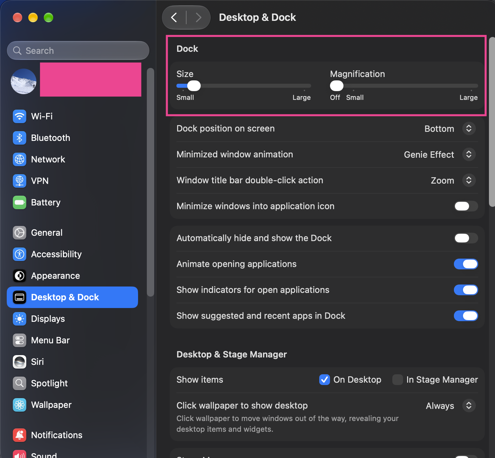
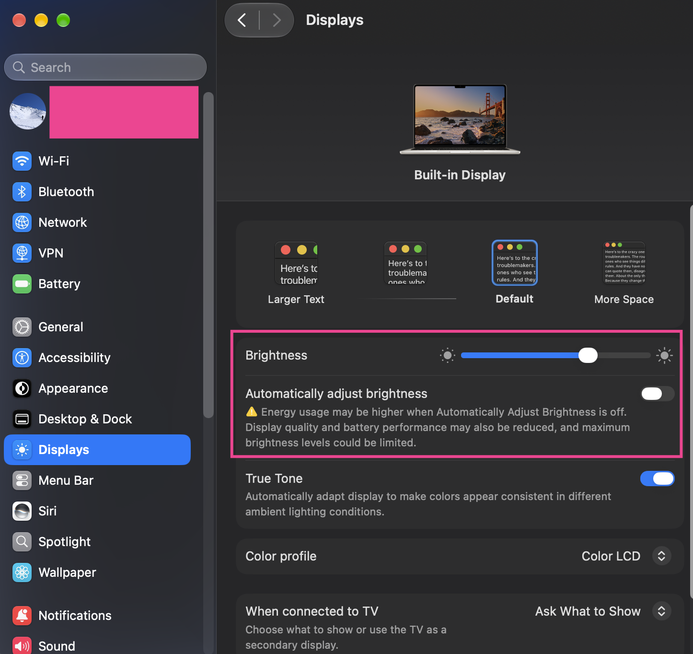
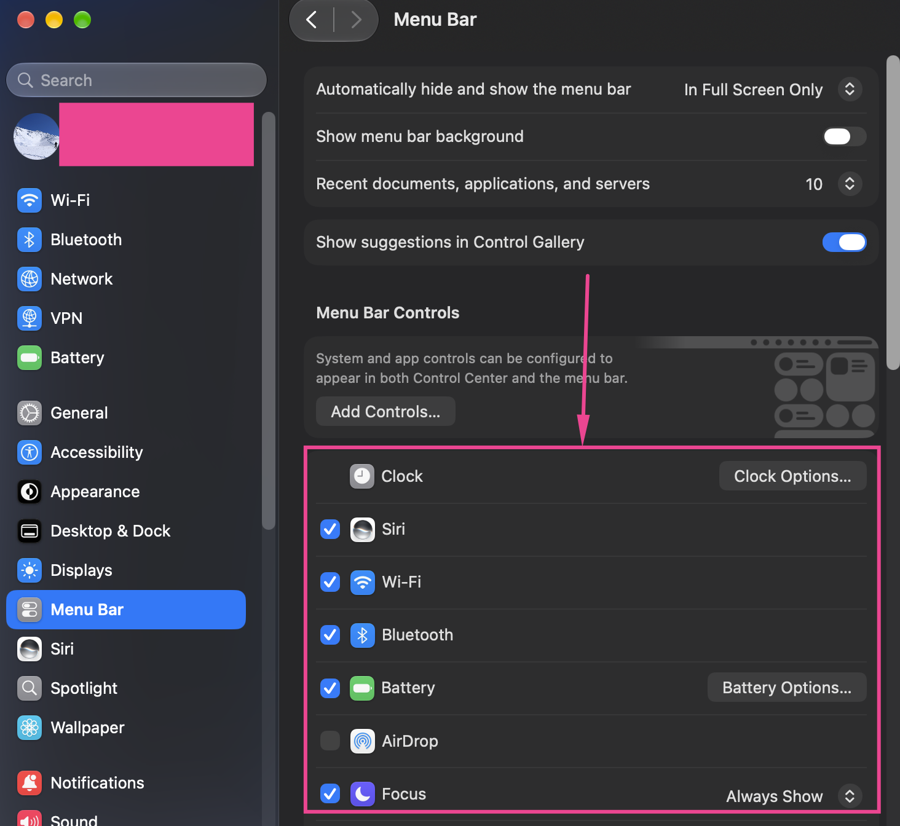

# これなに

PC を新しくするたびに初期セットアップでいろいろやっていたので、このあたりやっていたなあというものをまとめた個人メモです。

各ツールの詳しい使い方には触れません。公式のインストールページへのリンク集と、自分の設定ファイルの中身が主な内容です。


# 対象読者

- 新しい Mac をセットアップする未来の自分
- 他の人が何を入れているのか見てみたい人


# 最初にやること

## Homebrew

まずはいろんなものをインストールするにあたって便利な [Homebrew](https://brew.sh/) の準備。

```zsh
/bin/bash -c "$(curl -fsSL https://raw.githubusercontent.com/Homebrew/install/HEAD/install.sh)"
```

Apple Silicon の Mac では、インストール後に PATH を通します。

```zsh
echo 'eval "$(/opt/homebrew/bin/brew shellenv)"' >> ~/.zprofile
eval "$(/opt/homebrew/bin/brew shellenv)"
brew doctor
```

## GitHub の SSH キー

キーを作って、公開鍵（`.pub` の方）を [GitHub の設定画面](https://github.com/settings/keys) に登録します。

```zsh
ssh-keygen -t ed25519 -f ~/.ssh/[任意の名前]
pbcopy < ~/.ssh/[任意の名前].pub
```

コマンドは自分用のメモにも残しています。

[https://qiita.com/su3-hokkaido/items/05e9fb6b766bfefcc4f3](https://qiita.com/su3-hokkaido/items/05e9fb6b766bfefcc4f3)

# AI

自分が使っているところだとこのあたり。
Cursor, Copilot, Codex, Grok, Gemini CLI, Antigravity, Muse などいろいろあるのですが、2026年11月時点では自分は以下の3つでいろいろ回しています。


| ツール         | リンク                                                                              |
| ----------- | -------------------------------------------------------------------------------- |
| Orca        | [https://orca.dev/](https://orca.dev/)                                           |
| Claude Code | [https://claude.com/product/claude-code](https://claude.com/product/claude-code) |
| Devin       | [https://devin.ai/download](https://devin.ai/download)                           |


# Infrastructure

AWS を使うことが多いので、aws-cli は必ず入れています。

| ツール      | リンク                                                                                                                                                            |
| -------- | -------------------------------------------------------------------------------------------------------------------------------------------------------------- |
| AWS CLI  | [https://docs.aws.amazon.com/cli/latest/userguide/getting-started-install.html](https://docs.aws.amazon.com/cli/latest/userguide/getting-started-install.html) |
| OrbStack | [https://orbstack.dev/download](https://orbstack.dev/download)                                                                                                 |


# Frontend


| ツール               | リンク / コマンド                                                       |
| ----------------- | ---------------------------------------------------------------- |
| Node.js（npm, npx） | [https://nodejs.org/en/download](https://nodejs.org/en/download) |
| pnpm              | [https://pnpm.io/installation](https://pnpm.io/installation)     |
| TypeScript        | `npm install -g typescript`                                      |
| Prettier          | `npm install --save-dev --save-exact prettier`                   |


＊ Prettier はグローバルではなくプロジェクトごとにインストール。


# Backend

| 言語 / FW | リンク                                                                                |
| ------- | ---------------------------------------------------------------------------------- |
| Python  | [https://www.python.org/downloads/](https://www.python.org/downloads/)             |
| Django  | [https://www.djangoproject.com/download/](https://www.djangoproject.com/download/) |
| Dart    | [https://dart.dev/get-dart](https://dart.dev/get-dart)                             |
| Ruby    | [https://www.ruby-lang.org/en/downloads/](https://www.ruby-lang.org/en/downloads/) |
| Go      | インストール：`brew install go`<br>バージョンチェック：`go version`                                 |


# Mobile

Kotlin, Flutter をよく使うので以下2つ。
なお、Flutter には Dart SDK が同梱されているので、Dart を別に入れる場合はどちらの `dart` が使われているかを `which dart` で確認しておくと安心。

```zsh
brew install kotlin
brew install --cask flutter
```

# アプリ

## コミュニケーション・ブラウザ

- [Slack](https://slack.com/downloads/mac)
- [Chrome](https://www.google.com/chrome/)
- [Dia](https://www.diabrowser.com/)
- [Brave](https://brave.com/download/)

## ドキュメント・デザイン

- [Notion](https://www.notion.com/desktop)
- [Miro](https://miro.com/apps/)
- [Figma](https://www.figma.com/downloads/)

## 開発

- [VSCode](https://code.visualstudio.com/download)
- [Sublime Text](https://www.sublimetext.com/)
- [MySQL Workbench](https://dev.mysql.com/downloads/workbench/)
- [kubectl](https://kubernetes.io/docs/tasks/tools/install-kubectl-macos/)
- [Docker Desktop](https://docs.docker.com/desktop/setup/install/mac-install/)
- [Android Studio](https://developer.android.com/studio)
- Xcode（DeviceHub） => AppStore からインストール

OrbStack と Docker Desktop は役割が重なります。両方入れる場合は、今どちらを向いているかを `docker context ls` で確認する。
また、Docker Desktop は会社の規模などによって有料になるので、業務で使う場合はライセンスを確認。

## その他

- [Keka](https://www.keka.io/en/)（圧縮・解凍）


# アカウント

入社や案件参画のときによく発行や招待をお願いするものリスト。

- [ ] Jira
- [ ] Confluence
- [ ] Notion
- [ ] Miro
- [ ] Figma（Dev Seat あたりがあると良さそう）
- [ ] AWS
- [ ] Datadog
- [ ] Rollbar
- [ ] CircleCI
- [ ] Sentry
- [ ] Terraform
- [ ] Docker Hub（使っていれば）


# 設定

## Sublime Text

```json
{
    "draw_white_space": "all",
    "font_size": 16,
    "highlight_line": true,

    "tab_size": 4,
    "word_wrap": true,
    "ignored_packages":
    [
        "Vintage",
    ],
    "index_files": true,
}
```

## ~/.ssh/config

仕事用と個人用で GitHub アカウントを使い分ける設定をする。詳しくはこちら。

https://zenn.dev/su3_hokkaido/articles/2026-01-18_set_remote_url_of_github_host

## ~/.zshrc

Java の設定は `brew install openjdk@17` で入れた前提です。Android の `cmdline-tools` は Android Studio の SDK Manager から入れておきます。

```zsh
# Java
export PATH="/opt/homebrew/opt/openjdk@17/bin:$PATH"
export JAVA_HOME="/opt/homebrew/opt/openjdk@17/libexec/openjdk.jdk/Contents/Home"

# Docker
alias dk='docker'
alias dkp='docker ps'
alias dki='docker images'
alias dkpa='docker ps -a'
alias dkrm='docker rm'
alias dkc='docker container'
alias dkcm='docker compose up -d'
alias dkcmd='docker compose down'
alias dkstopa='docker stop $(docker ps -q)'

# k8s
alias kc='kubectl'

# npm
export NODE_OPTIONS="--max-old-space-size=8192"

# Android
export ANDROID_HOME="$HOME/Library/Android/sdk"
export PATH="$ANDROID_HOME/cmdline-tools/latest/bin:$PATH"
export PATH="$ANDROID_HOME/platform-tools:$PATH"

# Dart
export PATH="$PATH:$HOME/.pub-cache/bin"
## [Completion]
## Completion scripts setup. Remove the following line to uninstall
[[ -f $HOME/.dart-cli-completion/zsh-config.zsh ]] && . $HOME/.dart-cli-completion/zsh-config.zsh || true
## [/Completion]
```

## Mac 自体の設定

Dock を小さく、Magnification をオフにします。



Automatically adjust brightness は自分にとっては目がチカチカするのでマニュアルに。



メニューバーにバッテリーやBluetooth、Wifiなどは出しておきたいのでこのあたりもカスタム。




# さいごに

なんとなく頭の中で入れていた内容を吐き出してみたらそれなりにありました。
次のセットアップでこの記事を見ながら進めてみて、気が向いたら抜け漏れや古くなった情報を適宜更新していこうと思います。`brew bundle` で `Brewfile` にまとめてしまうのも良さそうなので、そのうち試してみます。
